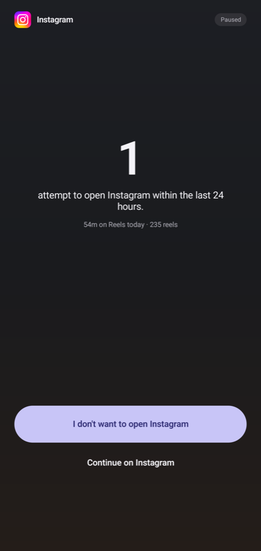
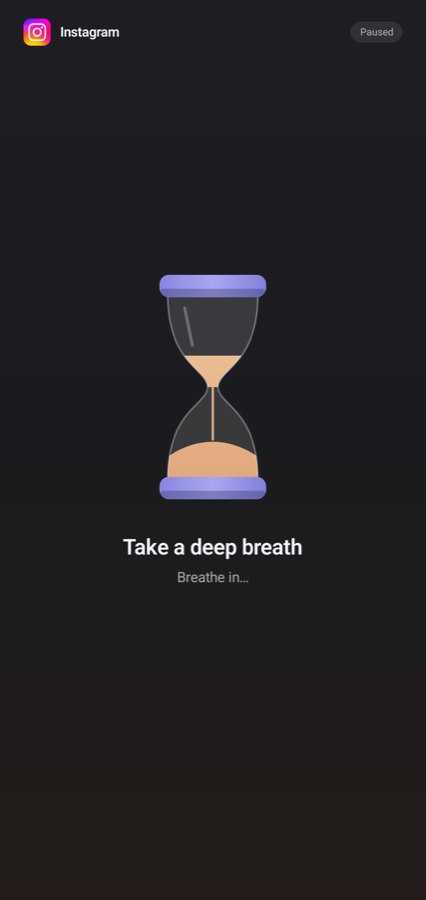
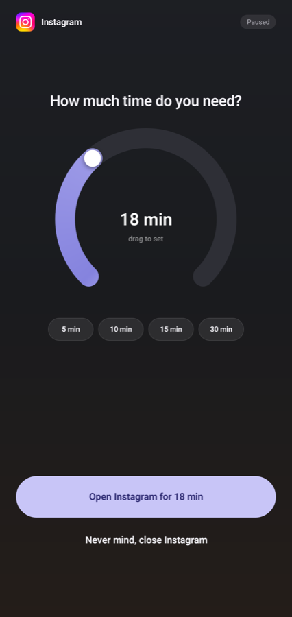
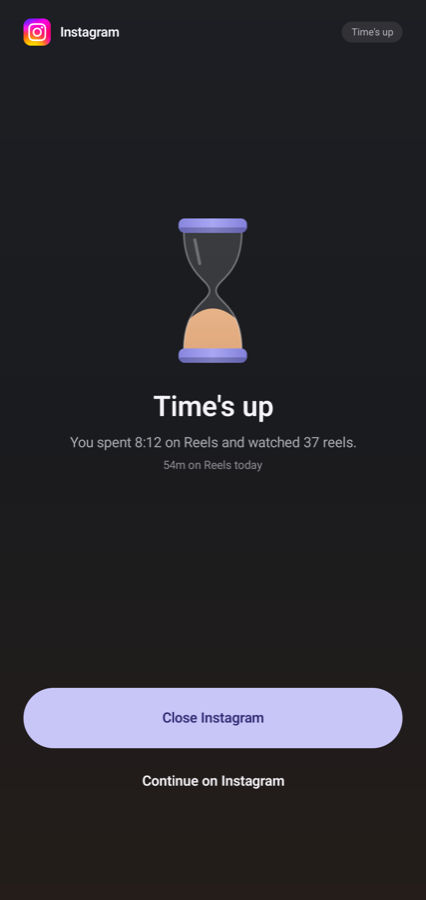
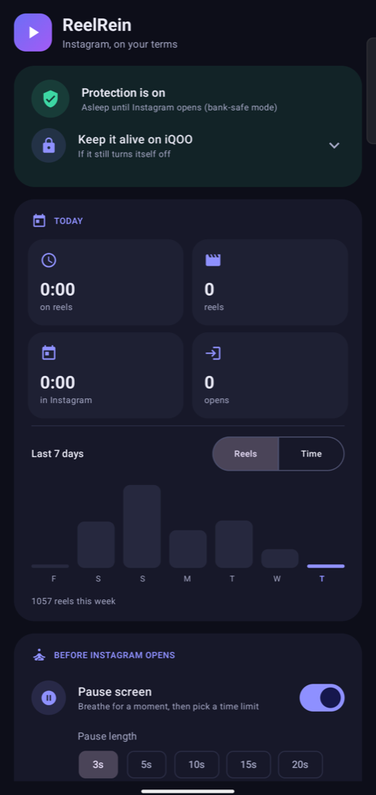

<div align="center">


# ReelRein

**Instagram on your terms.**<br>
A breath and a time limit before Instagram opens, a live counter of your time on Reels,<br>and every reel at 2× without touching the screen.

[](https://github.com/Naman503/reelrein/actions/workflows/ci.yml)
[](https://github.com/Naman503/reelrein/releases)
[](https://github.com/Naman503/reelrein/releases)


[](LICENSE)

<br>

## ⬇️ Download

<a href="https://github.com/Naman503/reelrein/releases/latest/download/ReelRein.apk"></a>
&nbsp;
<a href="https://apps.obtainium.imranr.dev/redirect?r=obtainium://app/%7B%22id%22%3A%22com.naman.reelrein%22%2C%22url%22%3A%22https%3A%2F%2Fgithub.com%2FNaman503%2Freelrein%22%2C%22author%22%3A%22Naman503%22%2C%22name%22%3A%22ReelRein%22%7D"></a>

[](https://github.com/Naman503/reelrein/releases/latest/download/ReelRein.apk)

<sub>**ReelRein.apk** · about 1 MB · Android 8.0+ · signed release build · [all versions & checksums](https://github.com/Naman503/reelrein/releases)</sub>

<sub>**GitHub** downloads the APK directly. **[Obtainium](https://github.com/ImranR98/Obtainium)** installs it and tells you when there's an update.</sub>

<br>



</div>

---

## 🚀 Install in 4 steps

| | Step | Where |
|:-:|---|---|
| **1** | **Download and open** `ReelRein.apk`. Allow your browser to install apps when asked. Play Protect may warn about an unknown developer: **More details → Install anyway**. | the badge above |
| **2** | **Turn on accessibility:** Finish setup → **Open** → Installed apps → ReelRein → **On**.<br><sub>Switch greyed out? Settings → Apps → ReelRein → **⋮ → Allow restricted settings**, then try again.</sub> | ReelRein app |
| **3** | **Allow background running** so the phone doesn't switch ReelRein off (setup card → **Allow**). | ReelRein app |
| **4** | **Open Instagram.** You'll see the pause screen. 🎉 | Instagram |

<sub>Vivo / iQOO, Xiaomi, Oppo, Samsung and others kill background apps. See [Keep it running](#-keep-it-running) if ReelRein turns itself off.</sub>

## 📑 Contents

[Why](#-why) · [Screenshots](#-screenshots) · [Highlights](#-highlights) · [Features](#-features-in-detail) · [Keep it running](#-keep-it-running) · [Bank-safe mode](#bank-safe-mode-optional) · [Permissions](#-permissions) · [Privacy](#-privacy) · [How it works](#-how-it-works) · [Limits](#-compatibility-and-limits) · [Build](#-build-from-source)

## 💡 Why

Instagram is built to keep you scrolling, and Android's own tools don't help much:

- **No pause before you open it.** You're three reels in before you've decided to open Instagram at all.
- **No honest counter.** Digital Wellbeing gives you a daily total, not "you've watched 40 reels in the last 12 minutes".
- **2× speed is a gesture you repeat on every reel.** You hold the screen, then slide down to lock 2×, and the lock resets on the next reel.
- **Auto scroll resets every session.** It's three menus deep, under ⋯ → Playback.

ReelRein sits next to Instagram and fixes all four. It has **no internet permission at all**, so nothing it sees can leave your phone.

## 📸 Screenshots

<table>
<tr>
<td width="25%"></td>
<td width="25%"></td>
<td width="25%"></td>
<td width="25%"></td>
</tr>
<tr>
<td><sub><b>1. Breathe</b> while the hourglass drains.</sub></td>
<td><sub><b>2. Attempts</b> in the last 24 hours. Closing is the easy choice.</sub></td>
<td><sub><b>3. How long?</b> Drag the dial, then open.</sub></td>
<td><sub><b>Time's up:</b> close, or choose a new time.</sub></td>
</tr>
</table>

<p align="center"><br><sub><b>Home:</b> protection status, today at a glance, the last 7 days.</sub></p>

## ✨ Highlights

| | |
|---|---|
| 🌬️ **Pause before opening** | An hourglass and a breath every time Instagram opens, then how many times you've tried to open it in the last 24 hours. It can get longer with each open today. Shows how many times you've opened it today and how long you've spent on Reels. |
| ⏱️ **A limit you choose** | Turn a round dial from 1 to 50 minutes (or tap 5 / 10 / 15 / 30). When time's up you either close Instagram or choose a new limit. There's no "just 5 more" button. |
| 🎬 **Live counter pill** | Time spent on Reels and reels watched, floating over Instagram. The ring fills as your limit runs out and turns amber in the last minute. |
| 🎛️ **Control panel** | Tap the pill for session and today stats, a 1× / 2× switch, Auto scroll, Change limit, Hide pill and End session. |
| 🎨 **Fully customisable** | Choose which numbers the pill shows, its size, style (solid / glass / outline), how far it fades when idle, what a tap does and which panel sections appear. There's a live preview in the app. |
| ⚡ **Every reel at 2×** | Uses Instagram's own "hold, slide down to lock 2×", once per reel. It waits for Instagram's hint before sliding, confirms the lock, skips ads, and never turns a press into a tap. |
| 🔁 **Auto scroll every session** | Switches on Instagram's own Auto scroll (⋯ → Playback) at the start of each session. It reads the switch first, so it never turns it off by mistake. |
| 🏦 **Bank-safe mode** | Optional. Accessibility is switched off whenever Instagram is closed, so banking apps that refuse to run with accessibility services work normally. |
| 🔒 **Private by design** | No internet permission, no accounts, no analytics. Daily totals only. It never reads captions, comments, usernames or messages. |
| 🔋 **Light** | While Instagram is closed it only listens for app switches. Scroll tracking runs only while Instagram is in front. The APK is about 1 MB. |

## 🧩 Features in detail

### Pause before Instagram opens
A calm, One Sec-style flow, one step at a time:
1. **Breathe.** An hourglass drains while you take a breath ("Breathe in… / Breathe out…"). It runs 3–20 s; with **Longer each time** on, every open today adds 3 s, up to 30 s. The timing follows the real clock, so your phone's animation speed can't shorten it.
2. **Attempts.** A big number: how many times you've tried to open Instagram in the last 24 hours, with your time and reels on Reels today. **I don't want to open Instagram** is the main button. **Continue on Instagram** is a quiet link.
3. **How much time do you need?** Drag the round dial (1–50 min, a haptic tick per minute) or tap 5 / 10 / 15 / 30, then **Open Instagram for N min**. It remembers your last choice.

These screens open as a normal full-screen page on top of Instagram, not a lock over the whole phone:
- **Phone keeps working:** Home, Back and the notification shade all work.
- **Instagram stops:** it pauses itself underneath, so the reel stops, and it picks up where you left off when you choose a time.
- **Leaving closes Instagram:** Back, **I don't want to open Instagram** or Home take you to the home screen and close Instagram.

The attempts screen also shows today at a glance: time on Reels, reels watched, time in Instagram, opens, and how today compares with yesterday.

**Pause again after closing Instagram for:** right away, 10 s (default), 30 s, 1, 2 or 5 min. Coming back sooner continues the same session, which is handy for share sheets and links. Coming back later means a new pause.

### Time's up
- A finished hourglass and what the session cost: time on Reels and reels watched.
- **Close Instagram**, or **Continue on Instagram** after a 3-second countdown, which takes you to the time dial. Continuing always means choosing how long.

### Counter pill and panel
- The pill shows time on Reels this session, reels this session and the 2× status. Optional extras: reels today, time on Reels today and time left.
- **Drag** it anywhere; it stays there. It fades when idle and brightens on every new reel.
- **Tap** opens the panel (or, if you prefer, toggles 2× or does nothing):
  - **This session:** time on Reels, reels watched, time left
  - **Today:** time on Reels, reels watched, opens
  - **Playback:** 1× / 2× every reel, Auto scroll on/off
  - **Change limit** (counted from now), **Hide pill** (until the next session), **End session**
- Everything is configurable under **Counter pill** in the app, with a live preview.

### 2× on every reel
Instagram's own 2× works like this: hold the edge of a reel, then **slide down to lock**. The lock resets on every reel, and the same slide on a locked reel *unlocks* it. ReelRein does this for you, carefully:

1. It waits until the reel has fully settled, so a press can never turn into a swipe to the previous reel.
2. It presses the right edge, above the like/comment column, and **waits for Instagram's own hint**:
   - "lock 2x": it slides.
   - "for normal speed": the reel is already locked, so it lets go.
   - No hint (a photo, an ad, a live video): it cancels.
3. It **confirms** with Instagram's "Locked at 2x speed" toast or, failing that, a second check. The pill shows 2× only once it's sure.
4. A press that nothing claimed is **cancelled, never lifted**. Lifting would count as a tap, and on an ad that opens the Play Store.
5. **Ads are skipped** entirely ("Ad", "Sponsored", "Install now", "Learn more"…).

Your own taps and swipes are never blocked: once locked, nothing stays pressed. Tap the pill's **1×** for normal speed. If your Instagram has no lock gesture, switch to the **Hold** method in settings. You can move the press point if it ever lands on a button.

### Auto scroll
At the start of every session, ReelRein switches on Instagram's own Auto scroll:
- It opens ⋯ → Playback → Auto scroll by clicking those exact items.
- It reads the real toggle first, so an already-on switch is left alone.
- It closes the menus afterwards.

It makes one attempt per session. If anything isn't where it expects, it backs out.

### Stats
- **Today:** time on Reels, reels watched, time in Instagram, opens.
- **Last 7 days:** a bar chart of reels watched or time on Reels.

### Bank-safe mode (optional)
Some banking apps refuse to open while *any* accessibility service is on. Android can't hide a service from other apps, so ReelRein switches its own service **off** 5 s after you leave Instagram. A tiny watcher switches it back on the moment Instagram opens. The watcher checks recent app launches every 0.8 s, and only while the screen is on.

The trade-off: Instagram may be visible for about a second before the pause screen covers it.

**Setup:** two one-time permissions.

1. **Usage access**, to notice Instagram opening: ReelRein → Banking apps → **Grant**.
2. **Permission to switch its own accessibility on and off.** Only a computer can grant this, once (USB debugging on):
   ```bash
   adb shell pm grant com.naman.reelrein android.permission.WRITE_SECURE_SETTINGS
   ```
   ReelRein uses it only to add or remove **its own** entry in the enabled accessibility services. You can take it back with `pm revoke`, or by uninstalling.

Then switch on **Only run while Instagram is open**.

## 🔋 Keep it running

Some phones stop background apps to save battery, and that switches ReelRein's accessibility service off. Fix it once:

| | |
|---|---|
| 🔋 **Battery** | Settings → Battery → Background power consumption / App battery saver → ReelRein → **Allow / No restrictions** |
| 🚀 **Autostart** | Settings → Apps → Autostart → ReelRein **on** (vivo / iQOO, Xiaomi, Oppo) |
| 📌 **Recents** | Pull down on ReelRein's card (or tap its 🔒 lock) so "Clear all" leaves it alone |
| 🛡️ **Advanced Protection** | Android 17's Advanced Protection turns off accessibility apps that aren't screen readers, so keep it off |

More per-brand tips: [dontkillmyapp.com](https://dontkillmyapp.com).

<details>
<summary><b>🔄 Updating, and moving from a self-built version</b></summary>

- **Updates:** a new APK installs over the old one and keeps your settings and stats (Obtainium does this for you).
- **Self-built version:** one you installed with `./gradlew installDebug` is signed with a different key, so **uninstall it once** before installing the release.
  - That resets your stats, and you'll need to turn accessibility on again.
  - If you use bank-safe mode, re-grant `WRITE_SECURE_SETTINGS`.
- **Checksum:** each release lists the SHA-256 of `ReelRein.apk`, and its signing certificate fingerprint is `DF:AF:E1:9C:DA:5F:94:7A:75:F2:2C:C9:B8:47:C5:06:49:95:11:56:CE:9C:6D:71:F1:DB:85:67:4E:FC:2D:22`.
</details>

## 🔐 Permissions

| Permission | Why | Needed? |
|---|---|---|
| Accessibility service | Notice Instagram opening, count reels, draw the pause screen and pill, press for 2×, switch Auto scroll | Yes |
| Battery optimisation exemption | Stop the phone from killing the service | Recommended |
| Usage access | Bank-safe mode: notice Instagram opening while the service is off | Bank-safe only |
| `WRITE_SECURE_SETTINGS` (via adb) | Bank-safe mode: switch its own service on and off | Bank-safe only |
| Notifications | Bank-safe mode's small "waiting for Instagram" notification | Bank-safe only |
| **Internet** | **Not requested.** It's removed from the manifest, and CI fails if it ever appears | Never |

## 🔒 Privacy

- **Nothing leaves the phone.** There's no internet permission, so it can't send anything anywhere.
- **What it looks at:**
  - which app is in front;
  - scroll events and view IDs inside Instagram (to count reels and find the Reels screen);
  - a handful of **Instagram's own UI labels**: the 2× hints ("Slide down to lock 2x speed", "…for normal speed"), the "Locked at 2x speed" toast, ad labels ("Ad", "Sponsored", call-to-action buttons) and the menu items on the way to Auto scroll.
- **What it ignores:** to find those labels, Android matches text on screen. ReelRein only checks for exact matches to the labels above, and never stores, logs or uses anything else: no captions, comments, usernames, messages or anything you type.
- **What it stores:** daily totals only (opens, reels, time in Instagram, time on Reels) and your settings, in app-private storage. Backups are off.
- **Debug log** (off by default): logs window and view IDs, never text, to logcat and a small private file.

## 🔍 How it works

```
LaunchWatcher (bank-safe only) ──switches on──▶ ReelReinService (AccessibilityService)
                                                 ├─ foreground check (which app window is really on top)
                                                 ├─ pause / time's-up / change-limit screens (accessibility overlays)
                                                 ├─ ReelCounter: Reels pager scroll events → reels watched
                                                 ├─ SpeedLock: hold → read hint → slide → confirm (per reel)
                                                 ├─ AutoScroll: ⋯ → Playback → Auto scroll toggle
                                                 └─ counter pill + panel, configurable
```

- **Overlays** are `TYPE_ACCESSIBILITY_OVERLAY` windows, so there's no "display over other apps" permission.
- **Gestures** go through `dispatchGesture`. Presses that should end without a tap are cancelled by starting a 1 ms tap on ReelRein's own invisible 2 px pad, which makes Android send `ACTION_CANCEL` to Instagram.
- **Instagram-specific details** (view IDs, labels, press point) live in one file: [`IgSignatures.kt`](app/src/main/java/com/naman/reelrein/IgSignatures.kt).

More background: [docs/RESEARCH.md](docs/RESEARCH.md) (how One Sec, ScrollToll and others do it) and [docs/PLAN.md](docs/PLAN.md).

## 🚧 Compatibility and limits

- **Tested on:** Instagram 450 (English) on an iQOO Z7 Pro, Android 15 / Funtouch OS 15. Needs Android 8.0+.
- **English only for 2× and Auto scroll:** they rely on Instagram's English labels. Counting, limits and the pill work in any language.
- **2× is the maximum:** that's all Instagram's player offers. Speeds in between (1.5×) aren't possible without root or a modified Instagram.
- **Instagram updates can move things.** Turn on **Debug log**, check the IDs and labels, and adjust [`IgSignatures.kt`](app/src/main/java/com/naman/reelrein/IgSignatures.kt).
- Not affiliated with Instagram or Meta. ReelRein never logs in, never talks to Instagram's servers and only acts on what's on your screen.

## 🔨 Build from source

Requirements: JDK 17, Android SDK with platform 37 (Android Studio installs it).

```bash
git clone https://github.com/Naman503/reelrein.git
cd reelrein
./gradlew :app:installDebug        # build + install on a USB-connected phone
./gradlew :app:assembleRelease     # app/build/outputs/apk/release/ReelRein-<version>-release.apk
```

Release builds are signed with the key in a git-ignored `keystore.properties` (`storeFile`, `storePassword`, `keyAlias`, `keyPassword`). Without one they fall back to the debug key; don't publish those.

### Making a release

1. Bump `versionCode` and `versionName` in `app/build.gradle.kts`, and write `docs/releases/vX.Y.Z.md`.
2. `git tag vX.Y.Z && git push origin vX.Y.Z`
3. The [Release workflow](.github/workflows/release.yml) then:
   - builds the APK, signed with the key from repository secrets (`RELEASE_KEYSTORE_BASE64`, `RELEASE_STORE_PASSWORD`, `RELEASE_KEY_ALIAS`, `RELEASE_KEY_PASSWORD`);
   - checks it isn't debug-signed and has no internet permission;
   - publishes the GitHub release with `ReelRein.apk` (a stable name, so `releases/latest/download/ReelRein.apk` always gets the newest) and its SHA-256.

## 📂 Project layout

```
app/src/main/java/com/naman/reelrein/
├─ ReelReinService.kt   accessibility service: sessions, reels, speed, pill
├─ SpeedLock.kt         Instagram's hold → slide → confirm 2× lock (and the Hold fallback)
├─ AutoScroll.kt        ⋯ → Playback → Auto scroll
├─ ReelCounter.kt       pager scroll events → reels watched
├─ LaunchWatcher.kt     bank-safe mode watcher + boot receiver
├─ A11yToggle.kt        switches ReelRein's own accessibility entry
├─ AudioGate.kt         mutes Instagram under the pause screen
├─ IgSignatures.kt      every Instagram-specific ID and label
├─ Store.kt             settings keys, pill config, daily stats
├─ overlay/             pause / time's-up screens, hourglass, time dial, pill + panel
└─ ui/                  Compose settings screen, theme, pill customiser
```

## 📄 License

[MIT](LICENSE) © 2026 Naman
